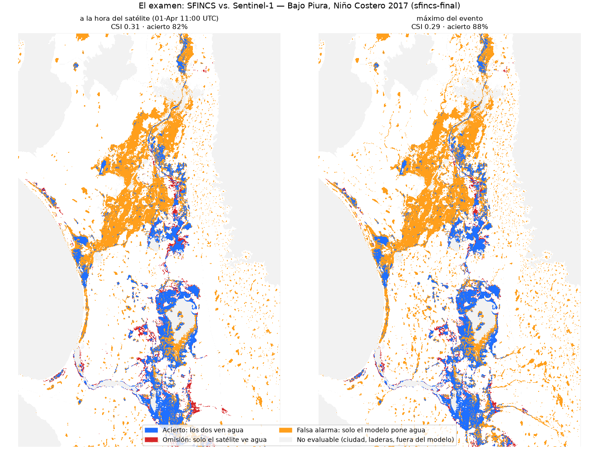

# Piura 2017: la inundación del Niño Costero simulada con software abierto

Reconstrucción de la inundación del río Piura (Niño Costero, marzo de 2017) con el software abierto de **Deltares** (Países Bajos), **solo con datos públicos y globales**, validada contra satélite (radar Sentinel-1 y Landsat 8).

> ⚠️ **Demostración técnica. No es un pronóstico oficial.** Sigue siempre los avisos de INDECI, SENAMHI y el ENFEN.

Proyecto personal y sin fines de lucro de Arnold Torres Larriega (ingeniero industrial, PMP), hecho con apoyo de inteligencia artificial (Claude Code). No soy hidrólogo: si eres especialista y ves algo mal planteado, abre un *issue*. Esa revisión es justamente lo que busco.

Explicación en video (divulgación): https://youtu.be/lE9HPCi1ZLE

## Resultados en una tabla

| Pregunta | Resultado |
|---|---|
| ¿El modelo de cuenca (Wflow) llega al pico? | 3,252 m³/s frente a 3,468 m³/s oficiales (94%), pero **4 días tarde** |
| ¿La mancha simulada (SFINCS) coincide con el satélite? | CSI **0.50** contra radar + Landsat (0.31 solo contra radar) |
| ¿Por qué el radar castiga al modelo? | ~**48%** de sus "falsas alarmas" eran agua real en Landsat (agua entre cultivos que el radar no ve) |
| Exposición con ≥ 60 cm de agua | ~50,900 edificios y ~160,800 personas (edificios de hoy, población 2017) |

Detalle completo, método y limitaciones: **[NOTA-TECNICA.md](NOTA-TECNICA.md)**.



*Examen contra el radar solo (CSI 0.31). Buena parte de lo naranja en el valle agrícola es agua entre cultivos que el radar no ve. Al sumar Landsat donde está despejado, el CSI sube a 0.50.*

## Stack

- **Wflow** (Julia 1.0.4) para la cuenca, armado con **HydroMT** (`hydromt_wflow` 1.1).
- **SFINCS** (Docker `deltares/sfincs-cpu`) para la inundación del Bajo Piura, armado con `hydromt_sfincs`.
- **Google Earth Engine** para Sentinel-1, Landsat 8, IMERG, ERA5-Land, MERIT Hydro, SoilGrids y WorldCover.
- Entorno reproducible con **pixi** (`pixi.toml` + `pixi.lock`).

## Cómo reproducirlo

Paso a paso, con los comandos exactos de la corrida final: **[REPRODUCIR.md](REPRODUCIR.md)**. En resumen: pixi + Julia + Docker en Windows, cuentas gratuitas de Earth Engine y Copernicus, y unos 10 GB de disco. Las descargas (`datos/`) y los modelos (`modelos/`) no se versionan: se regeneran con los scripts.

```
config/      recetas de HydroMT para Wflow (2017, 1998, lluvia alternativa)
geo/         cuenca, estación de caudal e infraestructura (OSM) en GeoJSON
scripts/     pipeline numerado, del 00 (entorno) al 29 (gráfico final)
validacion/  exámenes contra satélite, impacto, sensibilidad y animaciones (ver su LEEME.md)
web/         comparador antes/después del radar con barra deslizable (abrir index.html)
docs/        stack de Deltares, fuentes de datos con licencias y SFINCS en Docker
julia/       proyecto Julia con Wflow 1.0.4
```

## Licencias

- **Código** (`scripts/`, `config/`, `web/`): [MIT](LICENSE).
- **Textos** (`NOTA-TECNICA.md`, `docs/`, los README): [CC BY 4.0](LICENSE-CC-BY-4.0.md).
- **Resultados** (`validacion/`): CC BY 4.0 en lo que es mío, pero **derivan de datos de uso no comercial** (relieve FABDEM e hidrografía MERIT Hydro y Lin et al.). Por eso los mapas, animaciones y cifras de exposición **no se pueden usar con fines comerciales**.
- **Datos de terceros:** conservan su licencia. Los `geo/osm-*` son © colaboradores de OpenStreetMap ([ODbL](https://opendatacommons.org/licenses/odbl/)). La tabla completa con créditos está en [docs/02-fuentes-de-datos.md](docs/02-fuentes-de-datos.md).

## Agradecimientos

A **Deltares** y a los Países Bajos por publicar Wflow, SFINCS y HydroMT como software abierto. Al trabajo de Farías et al. (LACCEI 2020) sobre el pronóstico de caudales del río Piura y al de Reyes y Terrones (LACCEI 2020) sobre la medición del pico de 2017.

---

### English summary

Open reconstruction of the 2017 Coastal El Niño flood of the Piura river (Peru) using Deltares' open-source stack (Wflow + SFINCS + HydroMT) and only global/public data. The basin model reaches 94% of the official peak (3,252 vs 3,468 m³/s) but 4 days late. The flood extent scores CSI 0.50 against a combined Sentinel-1 + Landsat 8 reference, and about half of the radar "false alarms" turned out to be real water hidden under crops. This is a technical demonstration, not an official forecast. Feedback from hydrologists is very welcome: please open an issue. Code under MIT and texts under CC BY 4.0. The results derive from non-commercial datasets (FABDEM, MERIT Hydro), so they are for non-commercial use only. Step-by-step reproduction: REPRODUCIR.md (in Spanish).
