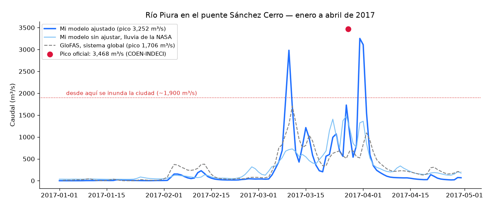

# Nota técnica: simulación de la inundación del río Piura, Niño Costero 2017

**Autor:** Arnold Torres Larriega · **Fecha:** octubre de 2026 · **Licencia del texto:** CC BY 4.0 (los resultados son de uso no comercial, ver README)
**Estado:** versión 1, **sin calibrar con caudal observado** (pedido por acceso a la información pública en trámite).

> Demostración técnica, no es un pronóstico oficial. Sigue a INDECI, SENAMHI y el ENFEN.

## 1. Pregunta

¿Se puede reproducir la inundación del Bajo Piura de marzo de 2017 con el software abierto de Deltares y solo datos globales, y qué tan bien sale contra lo que vio el satélite?

## 2. Evento de referencia

- Pico oficial en la estación Sánchez Cerro: **3,468 m³/s el 27-mar-2017 a las 12:00** (COEN-INDECI). Umbral de desborde en la ciudad: ~1,900 m³/s. Máximo histórico: 4,424 m³/s (1998).
- La serie horaria observada de la estación pertenece al Proyecto Especial Chira-Piura y no es pública. Por eso esta versión solo compara contra el pico.
- Reyes y Terrones (LACCEI 2020) plantean que el pico de 3,468 m³/s podría diferir ~16% del caudal recalculado a partir de los niveles. Esta incertidumbre queda abierta.

## 3. Método

### 3.1 Cuenca: Wflow
- Cuenca hasta Sánchez Cerro delimitada con HydroBASINS nivel 12: **7,570 km²**. Modelo a ~1 km, de jul-2016 a may-2017, con 6 meses de calentamiento.
- Insumos: MERIT Hydro, SoilGrids 2.0, MODIS LAI, WorldCover y ríos de Lin et al. (2019), vía un catálogo propio de HydroMT (el catálogo por defecto de Deltares apunta a su disco interno).
- Lluvia probada: **GPM IMERG V07** y **ERA5-Land**. En marzo de 2017 dan 454 mm y 752 mm sobre el área de estudio, respectivamente.

### 3.2 Inundación: SFINCS
- Dominio del Bajo Piura a 120 m, con subgrid de relieve FABDEM a 30 m (386,029 celdas), de lon −81.0 a −80.4 y lat −6.0 a −5.05. **El agua de 2017 salió de la cuenca** hacia la depresión de Sechura, así que el dominio no puede ser el polígono de la cuenca.
- Entrada: hidrograma de diseño con la **forma** de Wflow-IMERG, escalado ×2.34 y **anclado al pico observado** (27-mar 12:00 hora de Perú). Lluvia directa IMERG.
- Infiltración constante elegida por examen: 0, 1 y 2 mm/h dan un CSI de 0.48, **0.51** y 0.47, así que se usa 1 mm/h.

### 3.3 Examen contra satélite
- **Sentinel-1 (radar), 1-abr-2017:** detección de cambio contra una línea base seca (sep-dic 2016), a 30 m. La mancha observada es de 369.5 km².
- **Landsat 8, 4-abr-2017:** MNDWI > 0, solo en píxeles sin nube ni sombra (56% de la zona evaluable). Se usa como segunda opinión donde el radar y el modelo no coinciden.
- Métrica principal: **CSI** = aciertos / (aciertos + omisiones + falsas alarmas), con un umbral de profundidad de 10 cm.

## 4. Resultados

### 4.1 Caudal (Wflow)

| Variante | Pico 2017 | Fecha | Pico 1998 (obs. 4,424) |
|---|---|---|---|
| IMERG, sin ajustar | 1,480 m³/s (43%) | 27-mar ✅ | — |
| ERA5-Land, base | 5,515 (159%) | 9-mar | 9,141 (207%) |
| **ERA5-Land, pérdida profunda 20 mm/d** | **3,252 (94%)** | **31-mar (4 días tarde)** | 6,703 (152%) |
| ERA5-Land, pérdida profunda 50 mm/d | 1,876 (54%) | 10-mar | 4,435 (100%) |
| GloFAS v5 (referencia global) | 1,706 (49%) | 11-mar | — |

- El parámetro que manda es la **pérdida profunda hacia el acuífero**, coherente con el valle aluvial. El suelo, el flujo lateral y la rugosidad del río casi no mueven el pico.
- **Ningún valor único acierta 2017 y 1998 a la vez.** Se adopta 20 mm/d como valor central y 20–50 mm/d como banda de incertidumbre.
- IMERG clava la fecha y ERA5-Land se acerca a la magnitud. La lluvia real de 2017 probablemente está entre ambas.

### 4.2 Extensión (SFINCS, corrida final)

| Referencia | CSI | Tasa de acierto | Tasa de falsa alarma |
|---|---|---|---|
| Solo radar, a la hora del satélite | 0.31 | 82% | 67% |
| Solo radar, misma zona despejada | 0.36 | 83% | 61% |
| **Radar + Landsat (zona despejada)** | **0.505** | 66% | 32% |

- De las "falsas alarmas" despejadas, **48% eran agua en Landsat**: el radar no ve el agua entre cultivos, porque la vegetación inundada rebota la señal. Como controles, los aciertos son agua en Landsat en el 98% de los casos y las zonas secas para ambos solo en el 5%.
- Como orden de magnitud, en estudios de inundación con datos globales se suele considerar razonable un CSI cercano a 0.5. Aquí además la referencia es imperfecta: radar con puntos ciegos y Landsat cuatro días después.

### 4.3 Exposición (máximo del evento)

Exposición, no daño económico. Edificios de hoy (Google Open Buildings v3), población de 2017 (WorldPop) e infraestructura de OpenStreetMap (oct-2026).

| Profundidad | Edificios | Personas | Colegios | Salud |
|---|---|---|---|---|
| ≥ 10 cm | 78,755 | ~237,200 | 351 | 37 |
| **≥ 60 cm** (recomendado para comunicar) | **50,878** | **~160,800** | **207** | **18** |

La franja de 10–60 cm está inflada por el encharcamiento de lluvia y por agua transitoria.

## 5. Limitaciones conocidas

1. **Sin calibración con serie observada:** solo se compara contra un pico. El retraso de 4 días de Wflow no se puede corregir con rigor sin la serie horaria.
2. **El hidrograma de SFINCS está anclado al pico oficial**, así que la extensión no prueba la capacidad predictiva de la cadena completa, sino la de la parte hidráulica.
3. **El radar no ve agua en la ciudad** (los edificios rebotan la señal) ni bien en lagunas sobre arena. Landsat solo cubre el 56% despejado, cuatro días después del radar.
4. **Relieve global (FABDEM 30 m):** no representa diques, drenes ni defensas ribereñas de 2017.
5. **Exposición con edificios de hoy:** sobreestima lo que había en 2017. Falta contrastarla con los daños oficiales de INDECI.
6. El escenario de 1998 sobreestima el caudal ×1.5–2.1 con la misma configuración.

## 6. Próximos pasos

- Calibrar Wflow con la serie horaria de Sánchez Cerro y la curva de descarga, cuando lleguen.
- Decidir con especialistas si se calibra contra el pico oficial o contra el caudal recalculado.
- Contrastar la exposición con los daños oficiales de 2017.
- Recién después: escenarios para la temporada 2026-2027.

## Referencias principales

- Farías, M., Olivares, A., Neyra, D. y González, I. (2020). *Pronóstico de caudales del río Piura calibrado con El Niño Costero 2017.* LACCEI 2020.
- Reyes Salazar, J. et al. (2020). LACCEI 2020, artículo FP275. DOI [10.18687/LACCEI2020.1.1.275](https://doi.org/10.18687/LACCEI2020.1.1.275).
- COEN-INDECI, reporte de emergencia del 27-mar-2017 (pico de 3,468 m³/s en Sánchez Cerro).
- Hawker, L. et al. (2022). FABDEM. *Environmental Research Letters* 17, 024016.
- Yamazaki, D. et al. (2019). MERIT Hydro. *Water Resources Research* 55, 5053–5073.
- Lin, P. et al. (2019). Global reconstruction of naturalized river flows. *Water Resources Research* 55, 6499–6516.
- Deltares: Wflow, SFINCS y HydroMT (documentación oficial, ver [04-stack-deltares.md](04-stack-deltares.md)).
- Fuentes de datos y sus licencias: [03-fuentes-de-datos.md](03-fuentes-de-datos.md).
